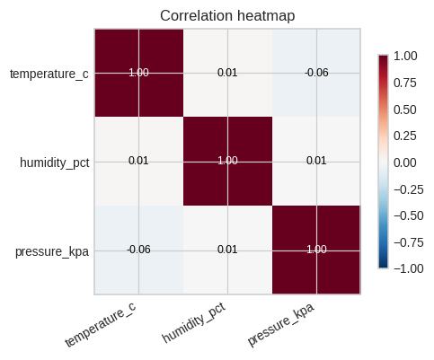
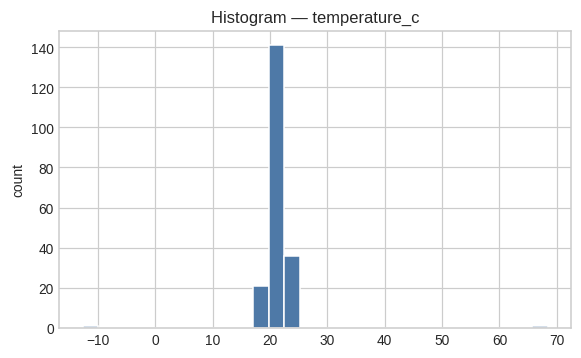

# 🔍 DataDetective

> Point at any CSV → get a full exploratory data analysis report. Profile, outlier flags, auto charts, and a self-contained HTML report — **100% offline, no API keys**.


## Features

- **One-shot data profile** — shape, dtypes, missingness %, cardinality, numeric summaries, top categorical values.
- **Outlier detection** — IQR (1.5×IQR fences) **and** z-score (|z| > 3) per numeric column, with the most extreme rows listed by index.
- **Auto charts** — histograms for every numeric column, bar charts for top categorical values, and a correlation heatmap (saved as PNG, embedded in the report).
- **Self-contained HTML report** — everything (tables + inline base64 images + plain-English *Findings* section) in one portable file.
- **CLI** — `profile`, `report`, and `demo` subcommands.
- **Bundled sample datasets** — synthetic sales, a customer list with missing values, and sensor readings with planted outliers.
- **Zero network calls** — runs fully offline; no API keys, no accounts.

## Tech stack

- **pandas** profiling (dtypes, missingness, cardinality, `describe()` summaries)
- **IQR / z-score** outlier detection (numpy)
- **matplotlib** charting (Agg backend — headless-safe)

## Screenshots

Sample report output on the bundled sensor data (note the planted temperature outlier):

| Correlation heatmap | Histogram — temperature_c |
|---|---|
|  |  |

## Quickstart

```bash
# 1. Clone and install
git clone https://github.com/872000/datadetective.git
cd datadetective
pip install -r requirements.txt

# 2. Run the test suite
python3 -m pytest -q          # 5 passed

# 3. Profile a CSV in the terminal
python3 -m datadetective.cli profile data/sensors.csv

# 4. Generate a self-contained HTML report
python3 -m datadetective.cli report data/sensors.csv --out report.html

# 5. End-to-end demo on all bundled datasets
python3 -m datadetective.cli demo
```

Example `profile` output:

```
File: data/sensors.csv — 200 rows × 5 columns
column              dtype       missing % cardinality
timestamp           object      0.0       200
device              object      0.0       3
temperature_c       float64     0.0       159
humidity_pct        float64     0.0       119
pressure_kpa        float64     0.0       109

Outliers flagged (IQR + z-score): 12
  temperature_c: 2 (extreme: row 17 = 68.4)
  humidity_pct: 5 (extreme: row 88 = 98.9)
  pressure_kpa: 5 (extreme: row 150 = 92.1)
```

## Project structure

```
datadetective/
├── datadetective/
│   ├── __init__.py      # public API: profile_csv, find_outliers, generate_report
│   ├── core.py          # CSV loading, data profiling, IQR + z-score outliers
│   ├── charts.py        # matplotlib chart builders (hist/bar/heatmap, base64 PNG)
│   ├── report.py        # self-contained HTML report + plain-English findings
│   └── cli.py           # profile / report / demo subcommands
├── data/
│   ├── sales.csv        # synthetic monthly sales (240 rows)
│   ├── customers.csv    # customer list with missing values (120 rows)
│   └── sensors.csv      # sensor readings with planted outliers (200 rows)
├── tests/
│   └── test_datadetective.py   # pytest suite (missingness, IQR, HTML sections)
├── docs/screenshots/    # hero banner + real report chart outputs
├── requirements.txt     # pinned: pandas, numpy, matplotlib, pytest
└── LICENSE              # MIT
```

## Roadmap

- [ ] Box plots and missingness matrix charts
- [ ] `--top-n` and `--z-threshold` CLI flags
- [ ] Support for Excel/Parquet inputs
- [ ] Numeric-cardinality "high-cardinality warning" heuristic
- [ ] Optional CSV export of flagged outlier rows

## License

MIT — see [LICENSE](LICENSE). Copyright (c) 2026 Parth (872000).
